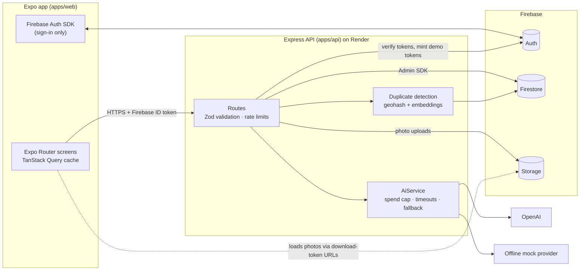

# CivicCircle

[](https://github.com/temitopeagbola/CivicCircle/actions/workflows/ci.yml)

Community issue reporting for residents and the moderators who handle their reports. Snap a photo of a local problem, drop a pin, and AI files it, rates its severity and flags duplicates nearby.

## Overview

Potholes, dead streetlights and fly-tipping get reported many times over, often without the detail needed to act. In CivicCircle a resident submits a photo, a map location and a short description. The API normalises the photo, runs moderation, and asks an AI provider for a category, a severity and a one-line summary. It then compares the report with active reports within 250 m from the last 30 days and flags likely duplicates, so neighbours can upvote one report instead of filing several. Moderators move reports through a status workflow with notes that residents can follow.

It is one Expo codebase for iOS, Android and the web, backed by a Node.js API on Firebase. OpenAI is used when a key is configured; otherwise a built-in offline provider handles triage.

**Production URL** (configured in `render.yaml` and the Netlify site): https://civiccircle.temitopeagbola.com

## Key features

- **Report an issue**: take a photo or pick one, describe it, and drop or drag a map pin (device location by default). Photos are re-encoded server-side with `sharp`, which strips EXIF and GPS metadata.
- **AI triage**: one of 9 categories, a severity (low / medium / high / urgent) with a confidence score, and a one-line summary. Text and image are moderated before anything is stored.
- **Duplicate detection**: geohash range queries plus embeddings, distance and category, shown to users as "84% match · 39 m away".
- **Feed** with status and category filters, newest or most-upvoted sorting, and infinite scroll.
- **Map**: severity-coloured markers (Leaflet + OpenStreetMap on web, `react-native-maps` on iOS/Android), "near me", and an accessible list view.
- **Upvotes and comments**: upvote counts are kept in Firestore transactions and update optimistically in the UI.
- **Moderation**:
  - status workflow: open → acknowledged → in progress → resolved, or duplicate; resolved and duplicate reports can be reopened
  - notes on each status change and confirmed-duplicate links
  - a monthly AI-spend meter for moderators
- **Cost and abuse controls**: per-IP rate limits and a hard monthly OpenAI spend cap. When the cap is reached, reports fall back to the offline provider and say so on the report.
- **One-click demo accounts** (resident and moderator), with seeded reports around London Bridge.
- **"Waking the server…" banner** when the free-tier API is cold-starting; loading, empty and error states throughout; responsive down to 375 px.

## Tech stack

| Layer         | Choice                                                                                              |
| ------------- | --------------------------------------------------------------------------------------------------- |
| Client        | Expo SDK 57 (React Native 0.86, React 19), Expo Router, TanStack Query, TypeScript                  |
| Web map       | Leaflet + react-leaflet with OpenStreetMap tiles (native: `react-native-maps`)                       |
| API           | Node.js, Express 5, Zod, `express-rate-limit`, `multer`, `sharp`, pino; bundled with tsup            |
| Data and auth | Firebase Auth, Cloud Firestore, Cloud Storage (`firebase-admin` on the API, Auth SDK on the client)  |
| AI            | OpenAI chat (structured output, optional vision), embeddings and moderation; offline mock provider  |
| Shared code   | `packages/shared`: Zod schemas, enums and DTO types used by both apps                                |
| Testing       | Vitest, Supertest, Firebase Emulator Suite, Playwright                                               |
| Hosting       | Netlify (web export), Render free web service (API, Docker), Firebase                               |
| Tooling       | npm workspaces, ESLint 9, Prettier, GitHub Actions, Docker Compose                                  |

## Architecture



- **The API is the only data path.** `firebase/firestore.rules` and `firebase/storage.rules` deny all client access, so validation, roles and rate limits live in the API.
- **Spend cap.** Before each paid OpenAI call the API reserves an upper-bound cost in `aiUsage/{YYYY-MM}` inside a Firestore transaction and refuses the call if it would exceed `OPENAI_MONTHLY_BUDGET_USD`. Afterwards it settles to the real cost from the token usage.
- **Embeddings.** Embeddings from different models are never compared. A deterministic hashed embedding is the common fallback.

The design notes are in [docs/PLAN.md](docs/PLAN.md).

## Project structure

```
apps/api/           Express API: routes, AI providers, Firestore/memory stores, seed scripts, Dockerfile
apps/web/           Expo app (iOS, Android, web export): src/app routes, components, lib
packages/shared/    Zod schemas, enums and DTO types shared by api and web
firebase/           Firestore and Storage security rules, Firestore composite indexes
e2e/                Playwright smoke tests and a static SPA server for the web export
docker/             Firebase Emulator Suite image and nginx config used by docker compose
docs/               Architecture and build plan
.github/workflows/  CI pipeline
docker-compose.yml  Full local stack
render.yaml         Render Blueprint for the API
netlify.toml        Netlify build for the web export
firebase.json       Emulator ports and rules/indexes paths
```

## Getting started

### Prerequisites

- **Node.js 24** (see `.nvmrc`; `package.json` requires `>=22.12`) and npm
- **Java 21+** to run the Firebase emulators outside Docker
- **Docker** with Compose, if you prefer the one-command setup

### Option A: everything in Docker

```bash
docker compose up --build
```

| Service                                   | URL                          |
| ----------------------------------------- | ---------------------------- |
| Web app                                   | http://localhost:8081        |
| API                                       | http://localhost:8787/health |
| Firebase Emulator UI (data, users, files) | http://localhost:4000        |

Compose runs the Firebase Emulator Suite (project `demo-civiccircle`, no credentials needed), seeds demo data, and starts the API and an nginx-served web export. Emulator data persists in a Docker volume; `docker compose down -v` wipes it. To use OpenAI, set `OPENAI_API_KEY` in `.env` before `up`.

### Option B: dev servers with hot reload

```bash
npm install
cp .env.example .env     # PowerShell: Copy-Item .env.example .env
npm run emulators        # terminal 1: Auth :9099, Firestore :8080, Storage :9199, UI :4000
npm run seed             # once: demo users and 16 reports
npm run dev:api          # terminal 2: API on http://localhost:8787
npm run dev:web          # terminal 3: Expo dev server; press "w" for web or scan the QR code with Expo Go
```

With the default `demo-civiccircle` project the web app uses the local emulators and needs no env file of its own. On a phone, set `EXPO_PUBLIC_API_URL` and `EXPO_PUBLIC_FIREBASE_AUTH_EMULATOR_URL` in `apps/web/.env` to your computer's LAN IP; Android emulators reach the host at `10.0.2.2`.

### Environment variables

Every variable is documented in [.env.example](.env.example). The API reads the root `.env`; Expo reads `EXPO_PUBLIC_*` variables at build time.

**API (`apps/api`)**

| Name                                                                                                                  | Purpose                                                                       |
| --------------------------------------------------------------------------------------------------------------------- | ----------------------------------------------------------------------------- |
| `NODE_ENV`, `PORT`, `LOG_LEVEL`                                                                                       | Runtime mode, listen port, log verbosity                                      |
| `CORS_ORIGINS`                                                                                                        | Browser origins allowed to call the API                                       |
| `TRUST_PROXY`                                                                                                         | Proxy hops to trust for client IPs used by rate limiting (`true` is rejected) |
| `FIREBASE_PROJECT_ID`                                                                                                 | Firebase project; `demo-civiccircle` works with the emulators                 |
| `FIREBASE_SERVICE_ACCOUNT`                                                                                            | Service-account JSON (raw or base64); required in production                  |
| `FIREBASE_STORAGE_BUCKET`                                                                                             | Storage bucket; defaults to `<project-id>.firebasestorage.app`                |
| `STORAGE_PUBLIC_URL`                                                                                                  | Public origin used to build photo URLs                                        |
| `FIRESTORE_EMULATOR_HOST`, `FIREBASE_AUTH_EMULATOR_HOST`, `FIREBASE_STORAGE_EMULATOR_HOST`                            | Point the Admin SDK at the local emulators                                    |
| `AI_PROVIDER`                                                                                                         | `auto`, `openai` or `mock`                                                    |
| `OPENAI_API_KEY`                                                                                                      | OpenAI key; leave empty to use the offline mock provider                      |
| `OPENAI_MODEL`, `OPENAI_EMBEDDING_MODEL`, `OPENAI_MODERATION_MODEL`                                                   | Models for classification, duplicate embeddings and moderation                |
| `OPENAI_MONTHLY_BUDGET_USD`                                                                                           | Hard monthly spend cap                                                        |
| `OPENAI_PRICE_INPUT_PER_1M`, `OPENAI_PRICE_OUTPUT_PER_1M`                                                             | Optional exact model prices for the spend cap                                 |
| `OPENAI_VISION`, `OPENAI_TIMEOUT_MS`                                                                                  | Send a downscaled photo to the model; per-call timeout before falling back    |
| `DEMO_LOGIN_ENABLED`, `DEMO_MODERATOR_ENABLED`                                                                        | Turn the one-click demo accounts on or off                                    |
| `RATE_LIMIT_GLOBAL_PER_15M`, `RATE_LIMIT_REPORTS_PER_HOUR`, `RATE_LIMIT_COMMENTS_PER_10M`, `RATE_LIMIT_DEMO_PER_15M` | Per-IP rate limits                                                            |

**Web app (`apps/web`, inlined at build time)**

| Name                                                                                                                                 | Purpose                                                         |
| ------------------------------------------------------------------------------------------------------------------------------------ | --------------------------------------------------------------- |
| `EXPO_PUBLIC_API_URL`                                                                                                                | Base URL of the API                                             |
| `EXPO_PUBLIC_FIREBASE_API_KEY`, `EXPO_PUBLIC_FIREBASE_AUTH_DOMAIN`, `EXPO_PUBLIC_FIREBASE_PROJECT_ID`, `EXPO_PUBLIC_FIREBASE_APP_ID` | Firebase web app config                                         |
| `EXPO_PUBLIC_FIREBASE_AUTH_EMULATOR_URL`                                                                                             | Auth emulator origin for local development; unset in production |

## Scripts

Run from the repo root.

| Command                                                 | What it does                                                             |
| ------------------------------------------------------- | ------------------------------------------------------------------------ |
| `npm run dev:api`                                       | API with hot reload (`tsx watch`), reading the root `.env`               |
| `npm run dev:web`                                       | Expo dev server (web, iOS, Android)                                      |
| `npm run emulators`                                     | Firebase Auth, Firestore and Storage emulators                           |
| `npm run seed`                                          | Demo users and reports; add `-- --reset` to wipe all reports first       |
| `npm run build:api`                                     | Bundle the API to `apps/api/dist`                                        |
| `npm run build:web`                                     | Expo web export to `apps/web/dist`                                       |
| `npm run preview:web`                                   | Serve `apps/web/dist` on http://localhost:8081 with an SPA fallback      |
| `npm run lint`                                          | ESLint plus a Prettier check                                             |
| `npm run format`                                        | Prettier write                                                           |
| `npm run typecheck`                                     | TypeScript across all workspaces and the e2e tests                       |
| `npm test`                                              | Unit and integration tests in every workspace                            |
| `npm run test:emulator`                                 | Store contract tests against the Firestore emulator                      |
| `npm run build:web:e2e` / `npm run test:e2e`            | Web export pointed at local services, then the Playwright smoke tests    |
| `npm run make-moderator -w @civiccircle/api -- <email>` | Promote an existing account to moderator (`--resident` to demote)        |

There are no database migrations: Firestore is schemaless, and composite indexes live in `firebase/firestore.indexes.json`.

## Testing

```bash
npm test                                  # unit + API integration tests, no services needed
npm run test:emulator                     # Firestore emulator contract tests (needs Java)
npm run build:web:e2e && npm run test:e2e # Playwright smoke tests (needs Java and a Playwright Chromium)
```

- **Unit and integration** (`npm test`):
  - API: mock classifier, severity rules, summaries, embeddings, duplicate scoring, pricing, spend-cap guard and photo processing
  - Supertest against `createApp()` with an in-memory store: auth, validation, reports, upvotes, comments, moderation and rate limits
  - shared schemas and the status workflow
  - web helpers and the "waking server" state machine
- **Store contract**: the same suite runs against the in-memory store and the real Firestore emulator.
- **End-to-end**: Playwright runs on a mobile viewport against the emulators, a freshly seeded API and the exported web build. It covers demo sign-in → report with photo → AI triage and duplicates → upvote → comment, plus a moderator status update.
  - Run `npx playwright install chromium` once before the first run.
  - `build:web:e2e` sets variables inline, so it needs a POSIX shell (macOS, Linux, WSL or Git Bash).

## Deployment

| Part          | Where                     | How                                                                                                                   |
| ------------- | ------------------------- | --------------------------------------------------------------------------------------------------------------------- |
| Web           | Netlify                   | `netlify.toml` runs `npm run build:web` from the repo root and publishes `apps/web/dist` with an SPA fallback; Node 24 |
| API           | Render (free web service) | `render.yaml` Blueprint: Docker build from `apps/api/Dockerfile`, health check `/health`, region Frankfurt            |
| Data and auth | Firebase                  | `npx firebase deploy --only firestore:rules,firestore:indexes,storage --project <project-id>`                         |

### First-time setup

1. **Firebase**:
   1. Create a project.
   2. Enable Email/Password sign-in and add the site domain under Authorized domains.
   3. Create Firestore and Storage. Cloud Storage requires the Blaze plan.
   4. Deploy the rules and indexes with the command above.
   5. Generate a service-account key and register a web app.
2. **Render**: New → Blueprint → this repo. Set `FIREBASE_PROJECT_ID`, `FIREBASE_STORAGE_BUCKET`, `FIREBASE_SERVICE_ACCOUNT` (base64) and, optionally, `OPENAI_API_KEY`. `render.yaml` presets the rest, including `CORS_ORIGINS` and `TRUST_PROXY=1`.
3. **Netlify**: set `EXPO_PUBLIC_API_URL` (the Render URL) and the four `EXPO_PUBLIC_FIREBASE_*` values from the web app config. Leave `EXPO_PUBLIC_FIREBASE_AUTH_EMULATOR_URL` unset, then deploy.
4. **Seed production**: run `npm run seed` with `FIREBASE_PROJECT_ID`, `FIREBASE_STORAGE_BUCKET` and `FIREBASE_SERVICE_ACCOUNT` set. The emulator host variables must be unset, otherwise the seed goes to your local emulators.

The free Render service sleeps when idle; the app shows a "Waking the server…" banner while the first request is slow.

### Known limitations

- The shared demo moderator lets any visitor change statuses; set `DEMO_MODERATOR_ENABLED=false` to turn it off.
- `TRUST_PROXY=1` assumes one proxy hop in front of the API on Render.
- The spend cap relies on the price table in `apps/api/src/ai/pricing.ts`. Unknown models are priced pessimistically unless `OPENAI_PRICE_*` is set.
- OpenStreetMap's public tiles are suitable for light demo traffic only.

## Contributing

1. Create a branch from `main` (`feat/…`, `fix/…`, `chore/…`).
2. Run `npm run lint`, `npm run typecheck` and `npm test` locally.
3. Open a pull request. CI (`.github/workflows/ci.yml`) runs three jobs:
   - lint, typecheck and unit tests
   - Firestore emulator and Playwright e2e tests
   - `docker compose build`
4. Merge once the checks are green and the PR is reviewed.

## License

All rights reserved.
