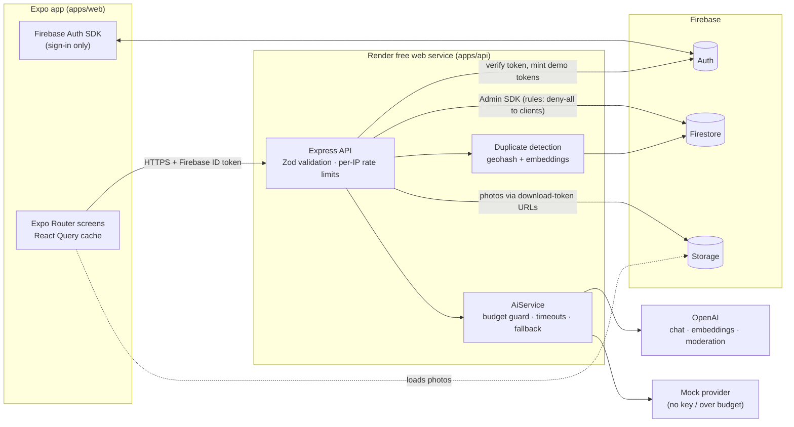

# CivicCircle

**Spot it. Snap it. Sorted.** CivicCircle lets residents report local problems such as potholes, dead streetlights and fly-tipping with a photo, a map pin and a sentence. AI then files the report: it picks a category, suggests a severity, writes a one-line summary and flags likely duplicates already reported nearby, so neighbours can back one report instead of filing ten. Moderators move reports from _open_ to _resolved_ with notes residents can follow. It is one Expo codebase that runs on iOS, Android and the web, with a small Node API on Firebase.

**Live demo:** https://civiccircle.temitopeagbola.com. Press **Try the demo** (no sign-up). The first request may take up to a minute while the free-tier API wakes up, and the app tells you when that is happening.

---

## Features

- **Report an issue**: take a photo or pick one, describe it, and drop or drag a pin (device location is used by default). Photos are re-encoded server-side, which strips EXIF/GPS metadata.
- **AI triage** (OpenAI, or the offline mock provider):
  - category (9 types) and severity (low → urgent) with a confidence score
  - one-line summary
  - **duplicate detection**: embeddings plus distance plus category against active reports within 250 m from the last 30 days, shown as "84% match · 39 m away"
  - content moderation of text and image before anything is stored
- **Feed** with status and category filters, newest or most-upvoted sorting, and infinite scroll.
- **Map**: severity-coloured markers (Leaflet + OpenStreetMap on web, native maps on iOS/Android), "near me", and an accessible list fallback.
- **Upvotes** (optimistic, transactional counter) and **comments**.
- **Moderation**: status workflow (open → acknowledged → in progress → resolved, or duplicate → reopen), notes, confirmed-duplicate links, and a monthly AI-spend meter.
- **Cost and abuse controls**: a per-IP rate limit and a hard **monthly OpenAI spend cap**. When the cap is reached, reports fall back to the mock provider and are labelled as such.
- **Free-tier friendly**: a "Waking the server…" banner when the Render API is cold-starting.
- One-click demo accounts (resident and moderator) with seeded data around London Bridge.
- Loading, empty and error states everywhere; responsive down to 375 px; labelled controls; visible keyboard focus.

## Architecture



- The **API is the only data path**. Firestore and Storage rules deny all client access, so validation, roles and rate limits live in one place, in TypeScript, with tests.
- **Shared contract**: `packages/shared` holds the Zod schemas, enums and DTO types used by both the app and the API.
- **Spend cap**: before every paid OpenAI call the API reserves an upper-bound cost in `aiUsage/{YYYY-MM}` inside a Firestore transaction and refuses the call if it would exceed `OPENAI_MONTHLY_BUDGET_USD`. Afterwards it settles to the real cost from the response's token usage, so concurrent requests can't overshoot the cap.
- **Duplicates**: candidates come from geohash range queries (`geofire-common`) and are filtered by exact distance. Embeddings from different models are never compared; a deterministic hashed embedding acts as the common fallback, so OpenAI-era and mock-era reports still match each other.

More detail is in [docs/PLAN.md](docs/PLAN.md).

### Repo layout

```
apps/api          Node.js + Express + TypeScript API (Render)
apps/web          Expo (React Native) app: iOS, Android, web export (Netlify)
packages/shared   Zod schemas, enums, DTO types
firebase/         Firestore/Storage rules (deny-all) and composite indexes
e2e/              Playwright smoke tests
docker/           Firebase emulator image, nginx config
```

## Run it locally

### Option A: everything in Docker (one command)

```bash
docker compose up --build
```

| What                                    | Where                        |
| --------------------------------------- | ---------------------------- |
| Web app                                 | http://localhost:8081        |
| API                                     | http://localhost:8787/health |
| Firebase Emulator UI (data, users, files) | http://localhost:4000      |

This runs the Firebase Emulator Suite (no Firebase project or credentials needed), seeds demo data, and starts the API and the web export. Emulator data persists in a Docker volume across restarts (`docker compose down -v` wipes it). To use real OpenAI locally, put `OPENAI_API_KEY=sk-…` in `.env` before `up`.

### Option B: dev servers with hot reload

Requires Node 22.12+ (24 LTS recommended) and Java 21+ for the emulators.

```bash
npm install
cp .env.example .env            # defaults point at the local emulators + mock AI
npm run emulators               # terminal 1: Auth, Firestore, Storage emulators (UI on :4000)
npm run seed                    # once: demo users + 16 reports
npm run dev:api                 # terminal 2: API on :8787 (tsx watch)
npm run dev:web                 # terminal 3: Expo dev server, press "w" for web or scan for Expo Go
```

The web app needs no env file locally: with the default `demo-civiccircle` project it talks to the emulators. For a phone running Expo Go, set `EXPO_PUBLIC_API_URL` and `EXPO_PUBLIC_FIREBASE_AUTH_EMULATOR_URL` in `apps/web/.env` to your computer's LAN IP (Android emulators use `10.0.2.2`).

### Tests

```bash
npm run lint            # ESLint + Prettier
npm run typecheck       # all workspaces + e2e
npm test                # unit + API integration tests (in-memory store, no services)
npm run test:emulator   # store contract suite against the real Firestore emulator
npm run build:web:e2e && npm run test:e2e   # Playwright smoke tests on emulators
```

| Suite                       | What it covers                                                                                                                                                                          |
| --------------------------- | --------------------------------------------------------------------------------------------------------------------------------------------------------------------------------------- |
| `apps/api` unit             | mock classifier, severity rules, summaries, hashed embeddings, duplicate scoring, pricing, budget guard (cap, concurrency, timeouts, refunds), photo processing (EXIF stripping), config |
| `apps/api` integration      | supertest against `createApp()` covering auth, validation, report creation, duplicates, pagination, upvotes, comments, moderator workflow, rate limits (429)                              |
| store contract              | the same suite against the in-memory store and the Firestore emulator (transactions, keyset pagination, geo queries, budget atomicity)                                                  |
| `apps/web` / `shared` unit  | "waking server" state machine, formatting, status workflow, schemas                                                                                                                     |
| Playwright e2e              | demo login → report with photo → AI triage + duplicates → upvote → comment → feed; moderator status update                                                                              |

CI (`.github/workflows/ci.yml`) runs all of the above plus `docker compose build` on every push and PR.

## Deploy

The web app deploys to Netlify and the API to Render; data lives in Firebase.

### 1. Firebase

1. Create a project at https://console.firebase.google.com.
2. **Authentication** → Get started → enable **Email/Password**. Under Settings → Authorized domains, add `civiccircle.temitopeagbola.com`.
3. **Firestore Database** → Create database (production mode, a region near your users, e.g. `europe-west2`).
4. **Storage** → Get started. Cloud Storage now requires the **Blaze (pay-as-you-go)** plan even though usage stays inside the no-cost quota. Set a budget alert at $1 in Google Cloud Billing.
5. Deploy rules and indexes from this repo:
   ```bash
   npx firebase login
   npx firebase deploy --only firestore:rules,firestore:indexes,storage --project <your-project-id>
   ```
6. **Project settings → Service accounts → Generate new private key.** Base64-encode the JSON for Render: `base64 -w0 key.json` (macOS: `base64 -i key.json`).
7. **Project settings → Your apps → Web app (</>)**: copy `apiKey`, `authDomain`, `projectId` and `appId` for Netlify.
8. Seed the demo data from your machine:
   ```bash
   FIREBASE_PROJECT_ID=<id> FIREBASE_STORAGE_BUCKET=<id>.firebasestorage.app \
   FIREBASE_SERVICE_ACCOUNT="$(base64 -w0 key.json)" npm run seed
   ```
   Run this without the emulator hosts: comment out the `*_EMULATOR_HOST` lines in `.env` first, otherwise the seed goes to your local emulators.

### 2. API on Render

1. Render dashboard → **New → Blueprint** → select this repo. `render.yaml` creates `civiccircle-api` (free plan, Docker, health check `/health`).
2. Fill the prompted secrets: `FIREBASE_PROJECT_ID`, `FIREBASE_STORAGE_BUCKET`, `FIREBASE_SERVICE_ACCOUNT` (base64), and optionally `OPENAI_API_KEY`.
3. Note the service URL, e.g. `https://civiccircle-api.onrender.com`.

### 3. Web on Netlify

The Netlify site is already linked to this repo. `netlify.toml` builds from the repo root and publishes `apps/web/dist`. Set the `EXPO_PUBLIC_*` variables below in Site configuration → Environment variables, then trigger a deploy.

## Environment variables

Every variable is documented in [.env.example](.env.example). These are the ones you set in production:

**Render (API)**

| Variable                    | Value                                                                  |
| --------------------------- | ---------------------------------------------------------------------- |
| `FIREBASE_PROJECT_ID`       | your Firebase project id                                               |
| `FIREBASE_STORAGE_BUCKET`   | `<project-id>.firebasestorage.app` (as shown in the Storage console)    |
| `FIREBASE_SERVICE_ACCOUNT`  | base64 of the service-account JSON                                     |
| `CORS_ORIGINS`              | preset to `https://civiccircle.temitopeagbola.com,https://civiccircle.netlify.app` |
| `TRUST_PROXY`               | preset to `1` (one proxy hop; see notes)                                |
| `OPENAI_API_KEY`            | optional; leave empty to run on the mock provider                        |
| `OPENAI_MODEL`              | preset to `gpt-4.1-mini`; any vision + JSON-schema chat model works      |
| `OPENAI_MONTHLY_BUDGET_USD` | preset to `5`                                                           |
| `DEMO_MODERATOR_ENABLED`    | preset to `true`; set `false` to stop public visitors moderating        |

**Netlify (web, inlined at build time)**

| Variable                                  | Value                                         |
| ----------------------------------------- | --------------------------------------------- |
| `EXPO_PUBLIC_API_URL`                     | the Render URL, e.g. `https://civiccircle-api.onrender.com` |
| `EXPO_PUBLIC_FIREBASE_API_KEY`            | from the Firebase web app config               |
| `EXPO_PUBLIC_FIREBASE_AUTH_DOMAIN`        | `<project-id>.firebaseapp.com`                 |
| `EXPO_PUBLIC_FIREBASE_PROJECT_ID`         | your Firebase project id                       |
| `EXPO_PUBLIC_FIREBASE_APP_ID`             | from the Firebase web app config               |
| `EXPO_PUBLIC_FIREBASE_AUTH_EMULATOR_URL`  | leave **unset**                                |

## Stack substitutions

**None.** The project uses the specified stack: Expo (React Native), a Node.js API, Firebase Auth/Firestore/Storage, and OpenAI. Additions that fill gaps rather than replace anything:

| Addition                                | Why                                                                                                                                         |
| --------------------------------------- | ------------------------------------------------------------------------------------------------------------------------------------------- |
| Express + Zod on the Node API           | Small, well known; Zod schemas are shared with the app (`packages/shared`).                                                                  |
| Leaflet + OpenStreetMap tiles (web map) | `react-native-maps` has no web support. The web build uses Leaflet via a `.web.tsx` file; iOS/Android keep native maps. Keyless and free.    |
| Firebase Emulator Suite                 | Replaces Postgres/Redis containers in `docker compose`: the whole system runs offline with no credentials, and CI tests against it.          |
| Mock AI provider                        | Required for running without keys: deterministic keyword classifier, rule-based severity, hashed bag-of-words embeddings, heuristic moderation. |
| In-memory rate-limit store              | Correct for the single Render instance. A Redis store (Upstash) would be the change if the API ever scales out.                              |

## Notes, risks and tech debt

- **Shared demo moderator**: anyone can sign in as the demo moderator and change statuses. That is intended for a portfolio, and can be switched off with `DEMO_MODERATOR_ENABLED=false`. To reset the demo data, run `npm run seed -- --reset --yes` against the project.
- **`TRUST_PROXY=1` on Render** assumes one proxy hop in front of the service. If rate limits seem to apply to everyone at once (or not at all), check the `X-Forwarded-For` chain Render sends and adjust the hop count. `true` is refused on purpose because it lets clients spoof their IP.
- **Spend cap accuracy** depends on the price table in `apps/api/src/ai/pricing.ts`. Unknown models are priced pessimistically ($5/$20 per 1M tokens) so the cap errs on the safe side; set `OPENAI_PRICE_*` for exact numbers.
- **Firebase Storage needs the Blaze plan**, which requires a billing account. Normal usage stays at $0; a budget alert is recommended.
- **OpenStreetMap tiles** are fine for a demo but not for heavy traffic ([tile usage policy](https://operations.osmfoundation.org/policies/tiles/)). A keyed provider would be the change for real usage.
- **Dependency audit**: the API's production dependencies audit clean (`npm audit --omit=dev -w @civiccircle/api`). The advisories `npm audit` shows for the whole workspace come from dev tooling (`firebase-tools`, the Expo CLI) and from Firebase JS SDK internals the web bundle doesn't import (Firestore's gRPC client). Watch for upstream fixes.
- Each authenticated request reads the user's profile (one Firestore read). A short TTL cache would cut that if traffic grows.
- The Expo web bundle is about 2.8 MB before compression, mostly Firebase, React Native Web and Leaflet. Route-level code splitting is the next step.
